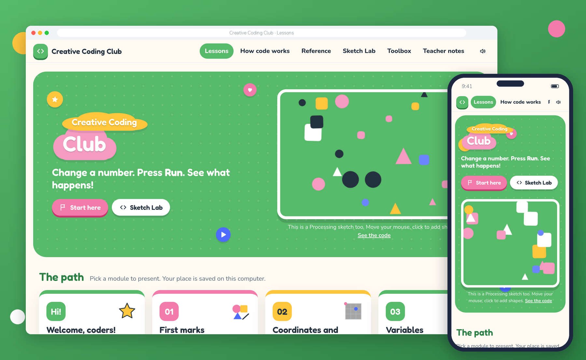
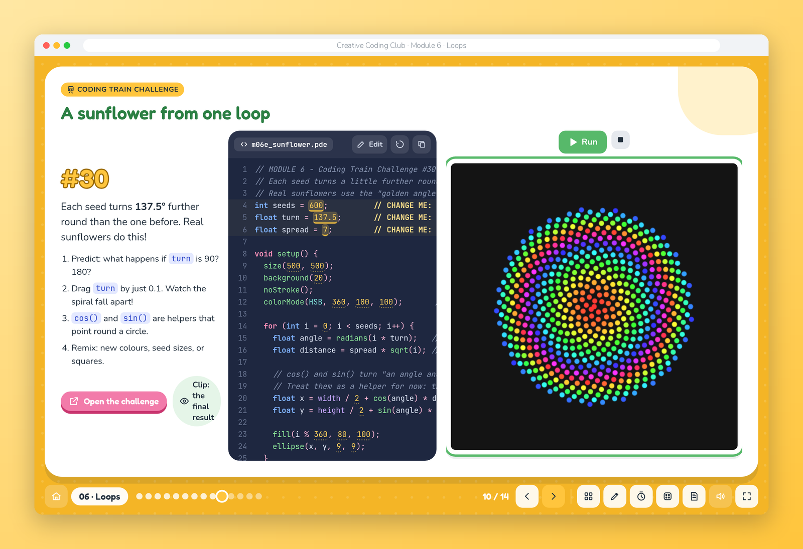
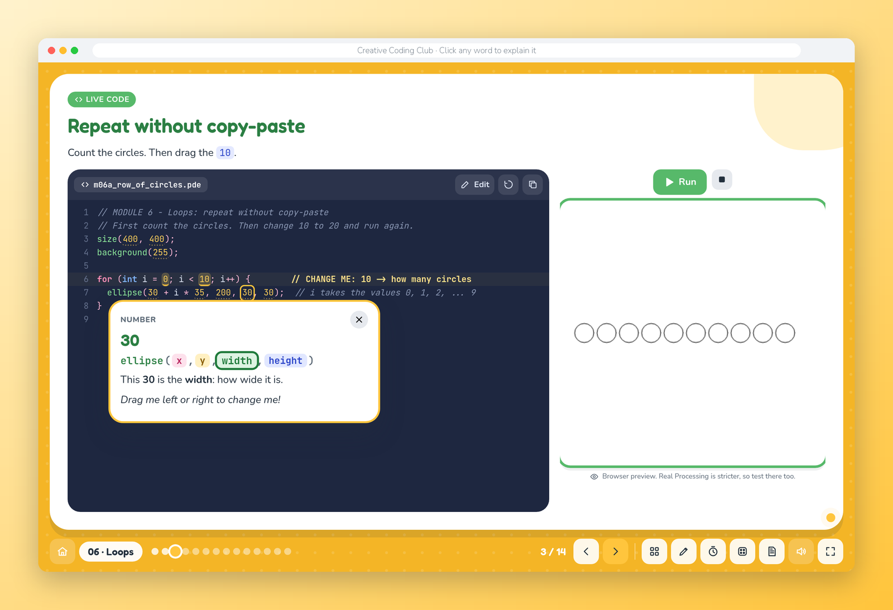
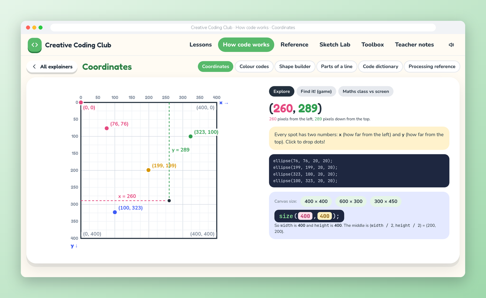
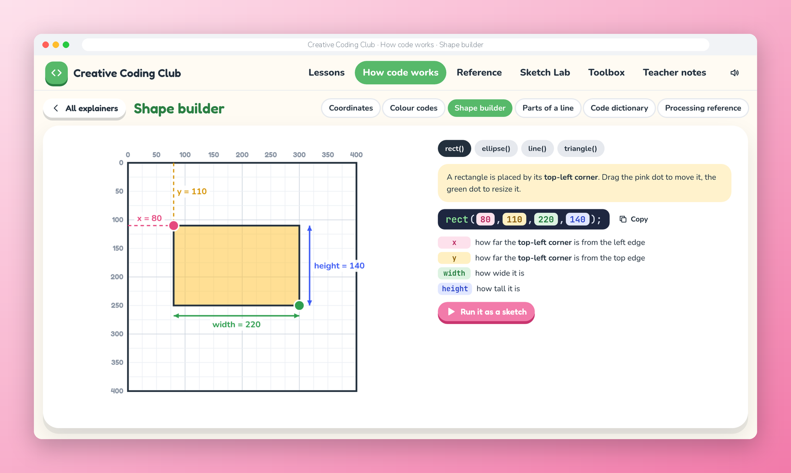
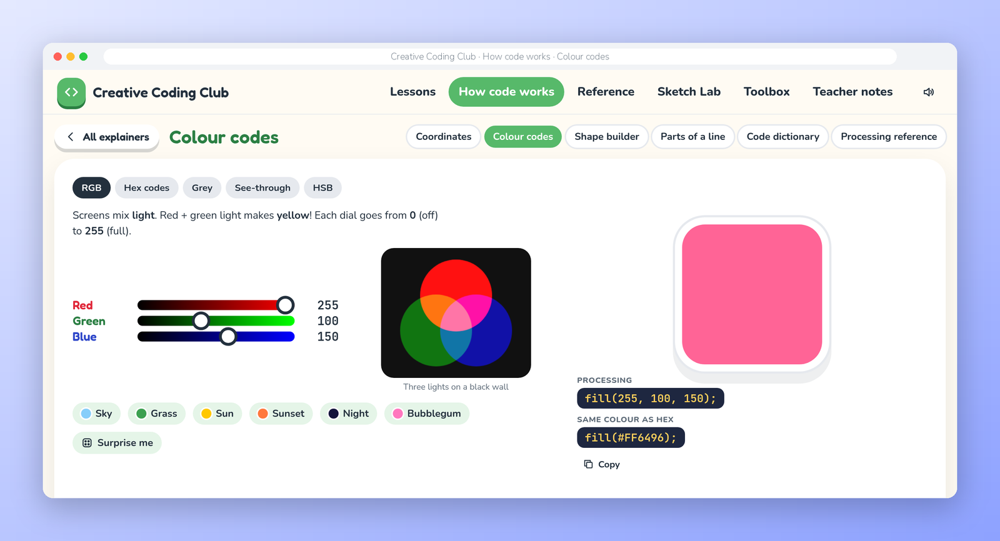
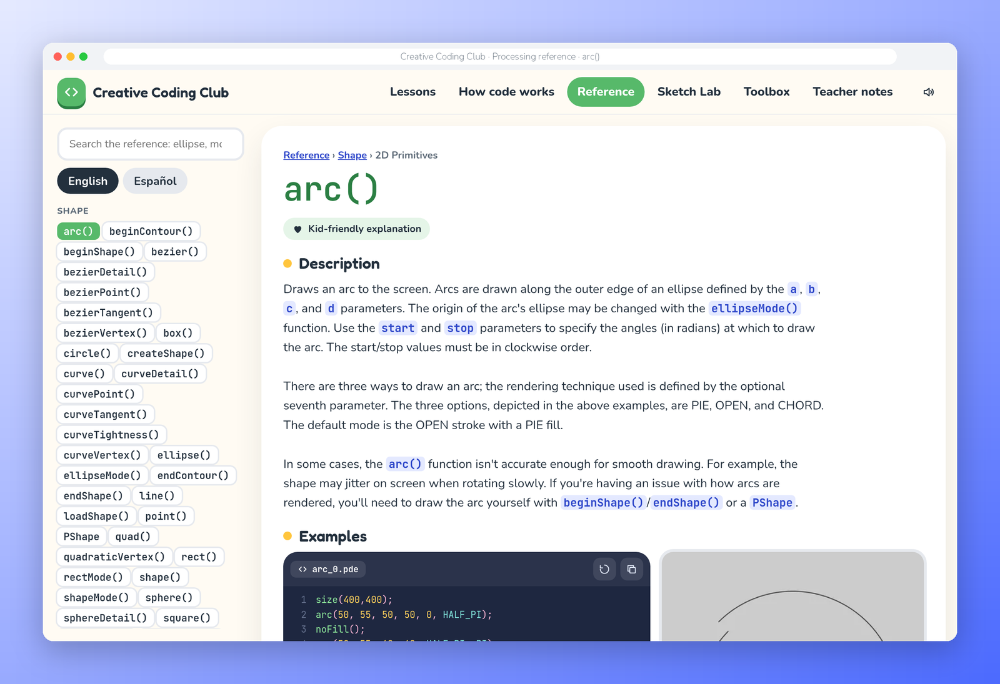
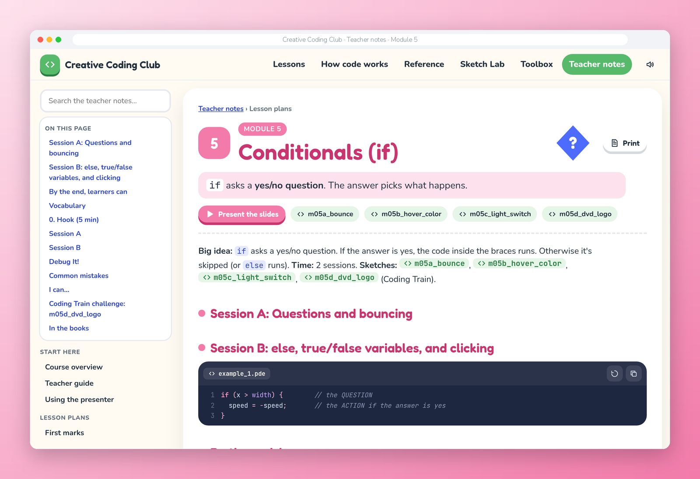
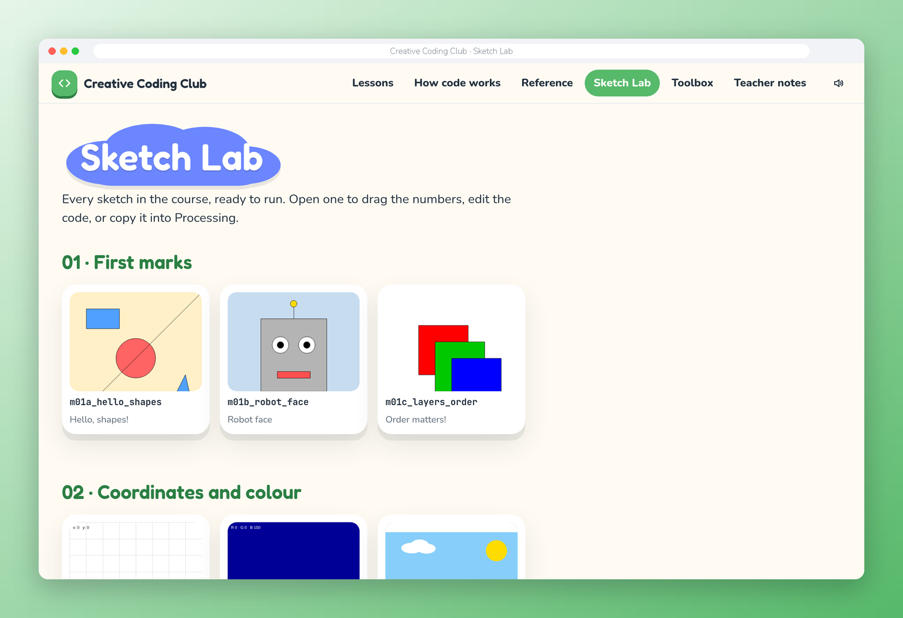

# Creative Coding for Kids: Processing First

A text-code course where every idea shows up on screen within seconds.
Kids don't drag blocks; they type real code, change a number, press Run, and *see* what happened.

**Try the presenter:** <https://jessaimaya.github.io/creative-coding-for-kids/>

<!-- screenshots -->

<!-- /screenshots -->

**Language:** Processing 4 (Java mode). **Ages:** designed for about 10-14 (see the pacing notes for younger or older groups).
**Session length:** 60 minutes. **Total:** about 16 sessions (full track) or 10 (short track).

## Why this course exists

Most first programming courses for kids use blocks. This one is for the next step: the first time a child types **real code**. That moment is fragile. A blank editor, a red error message and a page of rules can put a child off for good.

So the course is built so that every child succeeds in the first five minutes, and keeps succeeding:

- **Every idea is visual.** A shape, a colour, a movement. If the code does something, you can see it.
- **Nobody starts from a blank screen.** Each lesson begins with a working sketch to run and *predict*, then to change one number at a time, and only then to make something new (*Use, Modify, Create*).
- **Mistakes are part of the lesson.** *Debug It!* activities, an error-message decoder in kid language and the habit "read the red message, look at that line and the one above".
- **Explanations a 10-year-old can follow.** A variable is a labelled box, `draw()` is a flip-book, a function is a recipe, an array is a row of mailboxes.

The course comes with the **Creative Coding Club presenter**: a playful website for the projector, with a slide deck for every lesson and the course's sketches running live in the browser. The teacher can change the code in front of the class, and every word in it explains itself when clicked. It works offline, straight from the files: no server, no account, no internet.

The design follows research on teaching programming to beginners (PRIMM, Use-Modify-Create, worked examples, unplugged activities) and borrows the teaching moves of Daniel Shiffman's [Coding Train](https://thecodingtrain.com). [`DESIGN-REVIEW.md`](DESIGN-REVIEW.md) has the reasoning and the sources.

## What's inside

**The course**
- 11 modules, from the first `ellipse()` to games, objects and a bridge to p5.js, each with a full lesson plan
- 34 ready-to-run Processing sketches with `CHANGE ME` markers, compile-checked in Processing 4
- A teacher guide (the 60-minute session routine, how to explain each idea, how to handle bugs, assessment), a cheat sheet, a glossary, an error decoder, a book map and a Coding Train challenge for each module

**The presenter** (`site/index.html`)
- **Lessons:** 12 slide decks (153 slides) with predict-then-run, spotlighted lines, flip-card vocabulary, *Debug It!* reveals, "I can…" checklists and Coding Train challenges
- **Live code:** sketches run on the slide. Drag any yellow number to change it, edit anything, copy the code into Processing
- **Click to explain:** click any word, number or symbol in any code and a card says what it does, in kid language
- **How code works:** interactive explainers for coordinates (with a find-the-point game), colour codes (RGB, hex, HSB), a shape builder, the parts of a line of code, and a searchable code dictionary
- **Processing reference:** a local copy of [processing.org/reference](https://processing.org/reference) in the same style, with search, examples you can run and Spanish where translated
- **Sketch Lab:** every sketch of the course, ready to open and play with
- **Toolbox:** timer, name picker, whiteboard over any slide, grid paper
- **Teacher notes:** the lesson plans and resources, with the same live code, tickable checklists and a print layout

<!-- screenshots -->
## A tour

| | |
|---|---|
|  **Live code on every slide.** The code and the running sketch side by side. Drag a number and watch the picture change. |  **Click any word to explain it.** Numbers say what they do: "This 30 is the width: how wide it is." |
|  **How code works: coordinates.** Click to drop dots and see their code. Play the find-the-point game, or compare with the maths-class grid. |  **Shape builder.** Drag the corner and watch `rect(80, 110, 220, 140)` change with it. |
|  **Colour codes.** Three lights on a black wall, then RGB, hex, grey, see-through and HSB. |  **The Processing reference, offline.** All 671 entries with search and examples, linked to the kid-friendly explanations. |
|  **Teacher notes.** Lesson plans with the same live code, tickable checklists, a link to the slides and a print layout. |  **Sketch Lab.** Every sketch in the course, ready to run, change and copy into Processing. |

To retake these pictures after changing the site, run `./build-site.sh` and then `python3 tools/screenshots.py`.
<!-- /screenshots -->

## Quick start

**To teach with it,** open `site/index.html` in a current web browser. It works straight from the folder, offline. Press **?** for keyboard shortcuts; arrow keys move through the slides. Learners write their own code in Processing 4 (see [Setup](#setup-once) below).

**To change the course,** edit the Markdown files, the sketches or the decks in `present/decks/`, then rebuild:

```sh
./build-site.sh        # builds site/ (needs bash, pandoc 3 and python3)
```

Optional tools:

```sh
tools/update-processing-reference.sh   # refresh the local Processing reference (needs git and Pillow)
python3 tools/screenshots.py           # retake the README screenshots (needs Chrome and Pillow)
```

The live copy at <https://jessaimaya.github.io/creative-coding-for-kids/> is rebuilt by GitHub Actions on every push to `main` (`.github/workflows/pages.yml`). To serve your own copy instead of opening the file, run any static server from this folder, for example `npx vite serve ./`, and open `/site/`.

## How to use this folder

| Folder | What's in it |
|---|---|
| [`TEACHER-GUIDE.md`](TEACHER-GUIDE.md) | Read this first: the session routine, how to explain things, how to handle bugs, assessment |
| [`modules/`](modules/) | 11 lesson plans, one per module, each with demo script, tasks, "Debug It!" and reflection questions |
| [`sketches/`](sketches/) | 34 ready-to-run Processing sketches with `CHANGE ME` markers (all compile-checked in Processing 4) |
| [`sketches-p5/`](sketches-p5/) | Module 11 versions of the same ideas in p5.js (runs in the browser) |
| [`resources/`](resources/) | Cheat sheet, glossary, error-message decoder, book map, [Coding Train guide](resources/coding-train.md) (teaching moves + a challenge for each module) |
| [`present/`](present/README.md) | The presenter: a slide deck per module with live, editable sketches, plus a timer, name picker and whiteboard, a code dictionary and a local copy of the Processing reference |
| [`DESIGN-REVIEW.md`](DESIGN-REVIEW.md) | Why the course is designed this way: research on teaching first-time programmers, and recommendations |
| `tools/` | `update-processing-reference.sh` refreshes the local Processing reference, `build-notes.py` bundles the teacher notes into the presenter, `screenshots.py` retakes the README pictures |
| `docs/screenshots/` | The pictures in this README |
| `site/` | The website (build it with `./build-site.sh`, then open `site/index.html`): the presenter up front, these lesson pages behind it |

## The path

| # | Module | Big idea (kid words) | Sessions | Sketch folder(s) | Make-it-yours project |
|---|---|---|---|---|---|
| 1 | [First marks](modules/01-first-marks.md) | A program is a list of instructions, top to bottom | 1 | `m01*` | A robot / face from shapes |
| 2 | [Coordinates and colour](modules/02-coordinates-and-colour.md) | The screen is a grid; colour is three dials | 1 | `m02*` | A landscape scene |
| 3 | [Variables](modules/03-variables.md) | A labelled box: change it once, everything follows | 1 | `m03*` | A design-a-creature "dial panel" |
| 4 | [Animation](modules/04-animation.md) | `draw()` is a flip-book; a changing variable is movement | 1 | `m04*` | A character that moves and chases |
| 5 | [Conditionals](modules/05-conditionals.md) | `if` asks a question; the answer picks what happens | 2 | `m05*` | A bouncing ball, then a light switch |
| 6 | [Loops](modules/06-loops.md) | Repeat without copy-paste | 2 | `m06*` | A pattern poster |
| 7 | [Functions](modules/07-functions.md) | A named recipe you can reuse with new ingredients | 2 | `m07*` | A village built from your own recipes |
| 8 | [Randomness and arrays](modules/08-random-and-arrays.md) | Controlled surprise + a numbered row of boxes | 1-2 | `m08*` | Generative art posters |
| 9 | [Objects](modules/09-objects.md) | A blueprint that builds many things, each with its own data | 1 | `m09*` | Fireworks / creatures with behaviour |
| 10 | [Games](modules/10-games.md) | Input + conditionals + state + score | 2-3 | `m10*` | Their own game |
| 11 | [Bridge to p5.js](modules/11-bridge-to-p5js.md) | The same ideas, now in the browser and shareable | 1 | `sketches-p5/` | Publish one sketch |

**Short track (10 sessions):** 1, 2+3 combined, 4, 5 (one session), 6 (one), 7 (one), 8, 9 or 10 (pick one), final project, showcase.

## The rule that makes it work

Every module follows **Use, Modify, Create**:

1. **Use**: run a working sketch and *predict* what it does.
2. **Modify**: change the marked numbers one at a time and see what happens.
3. **Create**: make something of their own using the same idea.

Nobody starts from a blank screen until they're ready for one.

## Setup (once)

1. Install Processing 4 from <https://processing.org/download>.
2. Copy the `sketches/` folder to each learner's computer (or a shared drive). **Don't rename the inner `.pde` files**: Processing requires the folder and file name to match.
3. Open a sketch: *File > Open...* and choose the `.pde` file. Press the **Run** triangle. Press the **Stop** square to quit.
4. Learners should *Save As* a new name before they start changing things, so the original stays intact for the next group.

## Credits

- **Processing** ([processing.org](https://processing.org)) is the language the course teaches. The presenter runs sketches in the browser with [Processing.js](https://github.com/processing-js/processing-js) 1.6.6 (MIT). It's a preview: real Processing is stricter, so learners always test their work there.
- **The Processing reference** in `present/reference/` comes from [processing/processing-website](https://github.com/processing/processing-website) under **CC BY-NC-SA 4.0**: free for non-commercial teaching with the credit shown, not for a paid product without the Processing Foundation's permission. See `present/reference/LICENSE.md`.
- **The Coding Train** challenges are linked, not copied: the videos and code belong to Daniel Shiffman and [thecodingtrain.com](https://thecodingtrain.com).
- **Fonts:** Fredoka, Nunito and JetBrains Mono (SIL Open Font License), included in `present/vendor/fonts/`.

## License

The course, the presenter and the tools are released under the [MIT License](LICENSE): use them, change them and share them, in class or anywhere else. These parts come from other projects and keep their own licenses:

| Path | What | License |
|---|---|---|
| `present/reference/` | The Processing reference (text, syntax, example pictures) | [CC BY-NC-SA 4.0](present/reference/LICENSE.md), non-commercial |
| `present/vendor/processing.min.js` | Processing.js 1.6.6 | [MIT](present/vendor/LICENSE-processing-js.txt) |
| `present/vendor/fonts/` | Fredoka, Nunito, JetBrains Mono | [SIL Open Font License 1.1](present/vendor/fonts/OFL.txt) |

The book titles in `resources/book-map.md` and `DESIGN-REVIEW.md` are references only; no book content is included.
